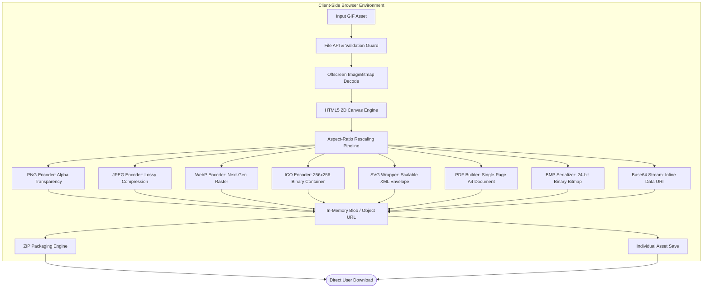

<div align="center">

# GIFForge Studio™

### Enterprise-Grade Client-Side GIF Conversion & Processing Engine

[](https://www.spmanchester.com)
[](LICENSE)
[](https://www.spmanchester.com)
[](SECURITY.md)
[](CONTRIBUTING.md)

<p align="center">
  <strong>High-performance, memory-efficient in-browser image rasterization and format conversion suite.</strong><br>
  No server latency &bull; Zero bandwidth costs &bull; Strict GDPR / HIPAA asset compliance &bull; Zero external runtime dependencies
</p>

[**Explore Live Portal**](https://serviceprovidermanchester.github.io/client-side-gif-converter/) &bull; [**Corporate Website**](https://www.spmanchester.com) &bull; [**Technical Lead**](#author--leadership) &bull; [**Enterprise Support**](mailto:info@spmanchester.com)

</div>

---

## 🚀 Built with ❤️ by SPManchester Private Limited

**GIFForge Studio™** is an open-source initiative designed, developed, and maintained by **SPManchester Private Limited** under the architectural direction of **Sayed Mudassar Akbar**. It addresses modern enterprise demands for ultra-fast, local, and private graphical asset processing.

---

## 📌 Executive Summary & The Problem It Solves

Most conventional image conversion platforms force organizations and creators to upload graphical assets to remote cloud servers. This standard approach introduces:
1. **Severe Security & Compliance Hazards**: Exposing confidential marketing material, intellectual property, or user data to third-party endpoints.
2. **Network Bottlenecks & Costs**: Uploading multi-megabyte GIF files wastes bandwidth and introduces noticeable latency.
3. **Vendor Lock-in & Pricing**: Rate limits, mandatory user subscriptions, watermarked files, and restrictive file quotas.

### The GIFForge Solution
**GIFForge Studio™** shifts 100% of the image decoding, rasterization, proportional scaling, color quantization, and binary encoding directly onto the visitor's hardware via standard **HTML5 Canvas 2D**, **Web APIs**, and **TypedArrays**. Zero bytes leave the client machine.

---

## 🏗️ System Architecture & Processing Pipeline



---

## 🧰 Conversion Engines Matrix

The suite is modularized into 8 dedicated standalone conversion applications:

| Module | Target Format | Key Engine Implementation | Use Case |
| :--- | :--- | :--- | :--- |
| [**`gif-to-png/`**](./gif-to-png/) | **PNG** (`.png`) | `HTMLCanvasElement.toBlob('image/png')` preserving full alpha transparency channel. | High-fidelity icons, transparent stickers, UI components. |
| [**`gif-to-jpg/`**](./gif-to-jpg/) | **JPG** (`.jpg`) | `image/jpeg` compression pipeline with dynamic 40%–100% quality slider & white flattening. | Photographic asset compression, bandwidth savings. |
| [**`gif-to-webp/`**](./gif-to-webp/) | **WebP** (`.webp`) | Modern WebP encoder yielding up to 35% smaller file sizes than traditional formats. | High-traffic web performance optimization. |
| [**`gif-to-ico/`**](./gif-to-ico/) | **ICO** (`.ico`) | 256×256 standard Windows icon container serialization. | Website favicons, desktop application icons. |
| [**`gif-to-svg/`**](./gif-to-svg/) | **SVG** (`.svg`) | Scalable vector envelope with embedded raster data stream. | Vector graphics pipelines and XML workflows. |
| [**`gif-to-pdf/`**](./gif-to-pdf/) | **PDF** (`.pdf`) | Single-page A4 document construction with proportional centering. | Formal documentation, printing, archiving. |
| [**`gif-to-bmp/`**](./gif-to-bmp/) | **BMP** (`.bmp`) | Pure JavaScript 24-bit binary bitmap writer (zero external libraries). | Legacy system compatibility, uncompressed editing. |
| [**`gif-to-base64/`**](./gif-to-base64/) | **Base64** (`.txt`) | Direct Data URI text generator (`data:image/png;base64,...`). | Inline CSS embedding, prototyping, web dev debugging. |

---

## ⭐ Key Enterprise Features

- **100% Client-Side Privacy**: Zero telemetry, zero server-side logging, zero data leaks.
- **Concurrent Batch Queue**: Drag and drop dozens of GIF files at once with instant preview cards and status badges.
- **Proportional Resizing Engine**: Aspect-ratio safe scaling with 100%, 75%, 50%, 25% presets or custom pixel width (1px to 16,000px).
- **In-Memory ZIP Bundler**: Download entire conversion queues in one click via a custom client-side ZIP serializer.
- **Zero Build Footprint**: Pure vanilla HTML, CSS, and modern JavaScript. Runs instantly without `npm install`, Node.js runtimes, or compilation steps.
- **Container Ready**: Includes production-grade Dockerfile and NGINX configurations for enterprise intranet deployments.

---

## 💻 Tech Stack

- **Core Runtime**: Native Modern ECMAScript (ES2022+), HTML5 Canvas 2D API, Web File API, TypedArrays
- **Styling**: Vanilla CSS3 Custom Properties, Responsive CSS Grid, Mobile-First Layouts
- **Deployment & Containers**: Docker, Alpine Linux, NGINX
- **CI/CD Automation**: GitHub Actions automated syntax and integrity testing

---

## 🏁 Quick Start & Deployment

### 1. Direct File System Execution (No Installation Required)
```bash
# Clone the repository
git clone https://github.com/serviceprovidermanchester/client-side-gif-converter.git
cd client-side-gif-converter
```
Simply double-click `index.html` or open it directly in any web browser (Chrome, Firefox, Safari, Edge).

---

### 2. Local HTTP Server
```bash
# Using Node.js
npx serve . -p 8080

# Or using Python
python -m http.server 8080
```
Visit `http://localhost:8080` to access the full portal suite.

---

### 3. Production Docker Deployment
```bash
# Build and run containerized NGINX instance
docker compose up -d
```
The suite will be available immediately at `http://localhost:3000`.

---

## 🗺️ Engineering Roadmap

- [x] 8 Dedicated standalone client-side conversion engines.
- [x] Unified enterprise launcher portal (`index.html`).
- [x] In-memory batch ZIP export generator.
- [x] Docker & NGINX production orchestration.
- [ ] Multi-frame animation deconstructor & frame-by-frame asset exporter.
- [ ] WebAssembly (Wasm) hardware-accelerated quantization module.
- [ ] Progressive Web App (PWA) offline installation manifests.

---

## 🤝 Contributing & Community Standards

We welcome contributions from developers worldwide! Please consult:
- [**Contributing Guidelines**](CONTRIBUTING.md) — Coding conventions, Git workflow, and PR standards.
- [**Code of Conduct**](CODE_OF_CONDUCT.md) — Community interaction standards.
- [**Security Policy**](SECURITY.md) — Vulnerability disclosure process.

---

## 👨‍💻 Author & Leadership

- **Lead Architect & Maintainer**: **Sayed Mudassar Akbar**
- **Email**: [info@spmanchester.com](mailto:info@spmanchester.com)
- **Organization**: **SPManchester Private Limited**
- **Official Website**: [www.spmanchester.com](https://www.spmanchester.com)

---

## 🏢 About SPManchester Private Limited

**SPManchester Private Limited** is an engineering and technology consulting company dedicated to developing robust, secure, and user-centric software solutions. From bespoke enterprise cloud platforms to high-performance client-side web utilities, we engineer software that prioritizes performance, security, and scalability.

- **Corporate Portal**: [https://www.spmanchester.com](https://www.spmanchester.com)
- **Inquiries & Custom Enterprise Development**: [info@spmanchester.com](mailto:info@spmanchester.com)
- **Portfolio & Case Studies**: [Explore Our Work](https://www.spmanchester.com)

---

## 📄 License

This project is open-source software licensed under the **MIT License**.  
Copyright &copy; 2026 **SPManchester Private Limited**. See the [LICENSE](LICENSE) file for complete details.
